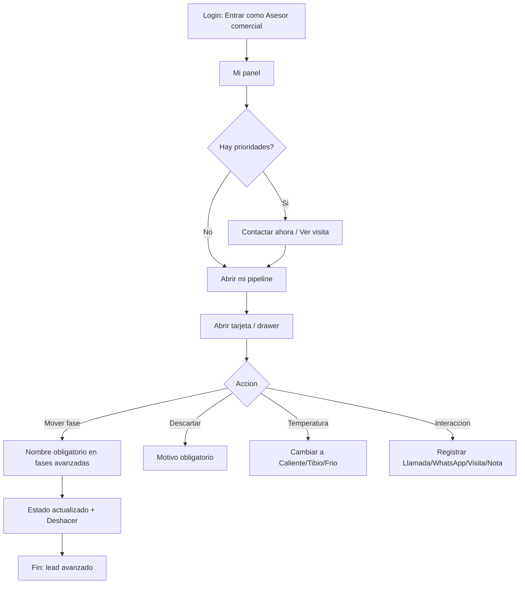

# Flujo del perfil — Asesor comercial

> Perfil de referencia del prototipo: **Aline Reyes** (Asesor comercial). Pantallas: **Mi panel** (`#/panel`) y **Mi pipeline** (`#/pipeline`).

## Perfil y objetivo

El Asesor comercial es quien trabaja el día a día del pipeline: **contacta rápido** (SLA de primer contacto de **15 min**), **registra cada interacción**, **agenda visitas** y **avanza el lead** por las fases hasta la venta o el descarte. Solo ve **sus propios leads**.

## Qué puede y qué NO puede

**Puede**

- Entrar desde la tarjeta **"Entrar como Asesor comercial"** o con el correo `asesor@crm.test`.
- Ver y trabajar **solo sus leads** en **Mi panel** y **Mi pipeline**.
- Registrar interacciones: **Llamada**, **WhatsApp**, **Visita**, **Nota**.
- Cambiar la **temperatura** del lead: **Caliente**, **Tibio**, **Frío**.
- Avanzar de fase por **drag & drop** o con **"Mover a…"** (alternativa accesible y táctil).
- **Descartar** un lead eligiendo un **motivo obligatorio**.
- Copiar el teléfono y abrir **WhatsApp**.
- Pausar su recepción con el interruptor **"Recibiendo leads" / "En pausa"**.
- Reasignar un lead **individual** desde el drawer ("Reasignar").
- **Deshacer** el último movimiento, cambio de temperatura o reasignación.

**NO puede**

- Ver los pipelines de **otros asesores** (el sistema solo muestra los leads asignados a él).
- **Reabrir** un lead en estado final: CALIFICADO o DESECHADO (aviso **"Estado final: solo Gerencia reabre"**).
- Saltar a **VISITA AGENDADA**, **NEGOCIACIÓN** o **CALIFICADO** **sin nombre** (aviso **"Requiere nombre"**).
- Descartar **sin motivo**.
- Acceder a **Dashboard**, **Leads**, **Equipo**, **Ingesta**, **Reportes**, **Auditoría**, **Usuarios** ni **Configuración**.

## Pantallas

| Pantalla | Ruta | Contenido |
|---|---|---|
| **Mi panel** | `#/panel` | Saludo del día, 5 KPIs, **Prioridades de hoy**, **Mi embudo**, **Mis leads por temperatura**, **Rendimiento vs equipo**, **Origen de mis leads**, **Agenda de visitas**, **Actividad reciente** |
| **Mi pipeline** | `#/pipeline` | Barra de resumen, buscador, filtros, chips, tablero **Tablero**/**Lista** y **drawer** del lead |

## Flujos paso a paso (a nivel de clic)

### 1. Entrar y ver el panel

1. En el login, pulsa la tarjeta **"Entrar como Asesor comercial"**.
2. Aterriza en **Mi panel**. Arriba a la derecha, el interruptor muestra **"Recibiendo leads"** (o **"En pausa"**).
3. Revisa los 5 KPIs: **Leads activos**, **Por contactar (SLA)**, **Visitas agendadas**, **Mi conversión**, **1.er contacto**.
4. En **Prioridades de hoy**, cada fila trae su etiqueta (**Fuera de SLA**, **Visita hoy**, **Caliente sin actividad**, **Reingreso**) y su botón de acción (**Contactar ahora**, **Ver visita**, **Retomar**, **Abrir**).

### 2. Contactar un lead fuera de SLA

1. Pulsa **"Contactar ahora"** en una fila con etiqueta **Fuera de SLA** (en rojo).
2. Se registra la interacción y el lead deja de estar fuera de SLA. Aparece el aviso **"Interacción registrada. Último contacto actualizado."**
3. Alternativa: en la tarjeta del Kanban, usa el botón rápido de **Registrar interacción** (ícono de mensaje).

### 3. Abrir el drawer y registrar una interacción

1. En **Mi pipeline**, pulsa una tarjeta (o pulsa `Enter` con la tarjeta enfocada) para abrir el **drawer**.
2. En **"Registrar interacción"**, elige el tipo (**Llamada**, **WhatsApp**, **Visita**, **Nota**), escribe una nota y pulsa **"Registrar"**.
3. Verás el nuevo evento al tope de la **"Línea de tiempo"**.

### 4. Agendar una visita (regla del nombre)

1. Abre una tarjeta **sin nombre** y arrástrala a **VISITA AGENDADA**.
2. La tarjeta **vuelve** a su columna y se abre el drawer con el foco en **"Nombre del cliente"** más el aviso **"Requiere nombre"**.
3. Escribe el nombre, vuelve a mover la tarjeta y ahora sí avanza. Aparece **"Estado actualizado: … → VISITA AGENDADA"** con el botón **"Deshacer"**.

### 5. Mover con "Mover a…" (alternativa táctil)

1. En la tarjeta, abre **"Más opciones"** y elige **"Mover a…"**.
2. En el menú, las fases no disponibles aparecen con su motivo; elige una fase válida.
3. Si eliges **DESECHADO**, se abre el diálogo **"Motivo de descarte"**: selecciona un motivo y confirma.

### 6. Cambiar temperatura

1. En el drawer, en **"Temperatura"**, pulsa **Caliente**, **Tibio** o **Frío**.
2. Aparece **"Temperatura: … → …"** con **"Deshacer"**.

### 7. Pausar la recepción de leads

1. En **Mi panel**, pulsa el interruptor **"Recibiendo leads"**.
2. Cambia a **"En pausa"** y los leads nuevos dejan de asignársele en el reparto automático.

## Atajos

| Tecla | Acción |
|---|---|
| `Ctrl` + `K` | Búsqueda rápida (leads y pantallas) |
| `D` | Mostrar / ocultar el **Modo demostración** |
| `?` | Abrir la ayuda (**Guía de mi rol**, atajos, reglas) |
| `Esc` | Cerrar el drawer, menú o diálogo activo |
| `Enter` / `Espacio` | Activar la tarjeta o control enfocado |
| `Tab` / `Shift`+`Tab` | Navegar entre controles (foco visible) |

## FAQ

**¿Por qué no puedo reabrir un lead desechado?**
Porque CALIFICADO y DESECHADO son estados finales para el Asesor. Verás **"Estado final: solo Gerencia reabre"**; pide a Gerencia que lo reactive.

**¿Por qué la tarjeta vuelve al arrastrarla?**
El lead no tiene nombre y la fase destino lo exige. Completa **"Nombre del cliente"** en el drawer y reintenta.

**¿Cómo muevo una tarjeta sin arrastrar?**
Usa **"Mover a…"** en el menú de la tarjeta o en el pie del drawer. Es la alternativa accesible y táctil.

**¿Qué significa el color rojo de una tarjeta?**
Que el lead sigue en **NUEVO** y superó el **SLA de 15 min** ("Sin contactar").

**¿Los cambios se guardan?**
No: es un prototipo sin backend. Todo vive en memoria y se reinicia con **Reiniciar demo** o recargando la página.
