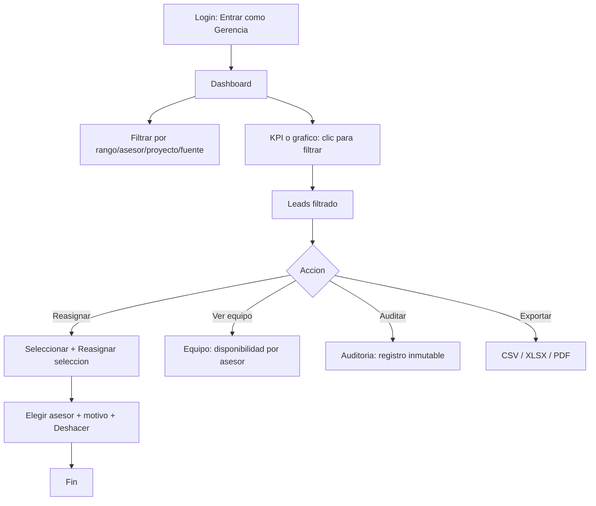

# Flujo del perfil — Gerencia

> Perfil de control: ve **todo el equipo**. Pantallas: **Dashboard**, **Leads**, **Equipo**, **Ingesta**, **Reportes**, **Auditoría**.

## Perfil y objetivo

Gerencia vigila el avance del equipo: lee el **consolidado en vivo**, detecta leads **fuera de SLA**, **reasigna** cuando hace falta (individual o en masa), **gestiona la disponibilidad** de los asesores, **reabre** leads en estado final y **audita** lo que ocurre en la sesión.

## Qué puede y qué NO puede

**Puede**

- Entrar como **"Entrar como Gerencia"** o con `gerente@crm.test`.
- Filtrar el **Dashboard** por rango (**Hoy**, **7 d**, **30 d**, **Este mes**, **Personalizado**), **Asesor**, **Proyecto** y **Fuente**; el botón **"Limpiar"** quita los filtros.
- Entrar desde cada KPI y cada gráfico al listado correspondiente: **"Sin atender (SLA)"**, barras de **"Leads por fuente"**, etapas del **"Embudo comercial"** y filas de **"Rendimiento por asesor"** (todas filtran **Leads**).
- Ver la lista **global** de **Leads**, buscar, filtrar por **Asesor** y **Estado**, y **exportar**.
- **Seleccionar** varios leads (**"Seleccionar"**) y pulsar **"Reasignar selección"** con un **motivo opcional** (queda en auditoría y se puede **Deshacer**).
- **Gestionar la disponibilidad** en **Equipo** con el interruptor por asesor.
- **Reabrir** leads en CALIFICADO o DESECHADO (esta acción no está bloqueada para Gerencia).
- Acceder a **Ingesta**, **Reportes** y **Auditoría**.
- Recibir **notificaciones** de SLA, reingresos, reasignaciones y cambios del equipo.

**NO puede**

- Entrar a **Usuarios** ni **Configuración** (reservadas al **Superadministrador**).
- Crear o desbloquear cuentas.
- Cambiar parámetros del sistema (adscripción, SLA, probabilidades): son de Configuración.

## Pantallas

| Pantalla | Ruta | Contenido |
|---|---|---|
| **Dashboard** | `#/dashboard` | Filtros + 5 KPIs + **Leads por fuente**, **Embudo comercial**, **Rendimiento por asesor**, **Tendencia de ingreso**, **Proyección por temperatura** |
| **Leads** | `#/leads` | Lista global con chips, búsqueda, filtros, selección múltiple y **Reasignar selección** |
| **Equipo** | `#/team` | Tarjeta por asesor: disponibilidad, **Carga abierta**, **Conversión**, **Fuera SLA** |
| **Ingesta** | `#/ingestion` | Alta rápida y carga masiva (misma pantalla que Recepción) |
| **Reportes** | `#/reports` | Catálogo de reportes con **CSV**, **XLSX**, **PDF** |
| **Auditoría** | `#/audit` | Listado inmutable con filtros por **Actor** y **Acción** |

## Flujos paso a paso (a nivel de clic)

### 1. Leer el consolidado

1. Entra como **Gerencia**: aterriza en **Dashboard**.
2. Cambia el rango con **Hoy**, **7 d**, **30 d**, **Este mes** o **Personalizado**.
3. Filtra por **Asesor**, **Proyecto** o **Fuente**; combínalos y usa **"Limpiar"** para reiniciar.

### 2. Ir del KPI al listado filtrado

1. Pulsa la tarjeta **"Sin atender (SLA)"**.
2. Se abre **Leads** con el chip **Sin atender** activo. Revisa, contacta o reasigna.
3. Vuelve al **Dashboard** y pulsa una barra de **"Leads por fuente"** o una etapa del **"Embudo comercial"**:
   - Barra de fuente → **Leads** filtrado por esa fuente.
   - Etapa del embudo → **Leads** filtrado por ese **Estado**.
   - Fila de **"Rendimiento por asesor"** → **Leads** filtrado por ese asesor.

### 3. Reasignar en masa

1. En **Leads**, pulsa **"Seleccionar"**.
2. Marca las casillas de los leads que quieras (verás **"N seleccionados"**).
3. Pulsa **"Reasignar selección"**.
4. En el diálogo **"Reasignar N leads"**, elige el asesor destino (los que están **en pausa** aparecen deshabilitados) y escribe un **motivo** (opcional).
5. Confirma: aparece **"N leads reasignados a …"** con **"Deshacer"** y el cambio queda en **Auditoría**.

### 4. Gestionar la disponibilidad

1. Ve a **Equipo**.
2. Usa el interruptor de un asesor (tooltip **"Recibir leads por Round-Robin"**).
3. Al pausarlo, deja de recibir leads nuevos en el reparto automático (útil para equilibrar carga).

### 5. Reabrir un lead final

1. Abre un lead **CALIFICADO** o **DESECHADO** (desde **Leads** o el Kanban).
2. Con **"Mover a…"** o el **stepper** del drawer, muévelo a una fase abierta. Para Gerencia la acción está permitida.

### 6. Auditar y exportar

1. Ve a **Auditoría**: verás el aviso **"Registro inmutable"** y la tabla **Cuándo · Actor · Rol · Acción · Entidad · Detalle**.
2. Filtra por **Actor** o **Acción**, o busca en el detalle; usa **"Limpiar"** para reiniciar.
3. En **Reportes** o en la barra de **Leads**/**Dashboard**, pulsa **"Exportar"** (o **CSV**/**XLSX**/**PDF**): aparece **"Generando …"** y luego **"… listo para descargar (URL válida 15 min)."**

## Atajos

| Tecla | Acción |
|---|---|
| `Ctrl` + `K` | Búsqueda rápida (leads y pantallas) |
| `D` | Mostrar / ocultar el **Modo demostración** |
| `?` | Ayuda (**Guía de mi rol**, atajos, reglas) |
| `Esc` | Cerrar diálogo, menú o drawer |
| `Enter` / `Espacio` | Activar la fila o control enfocado |

## FAQ

**¿Por qué no veo "Usuarios" ni "Configuración"?**
Son pantallas del **Superadministrador**. Gerencia gestiona operación y equipo, no accesos ni parámetros.

**¿Qué pasa si reasigno a un asesor en pausa?**
No se puede: figura deshabilitado con el texto **"en pausa"**.

**¿La reasignación se puede deshacer?**
Sí. Los avisos de reasignación (individual y masiva) incluyen **"Deshacer"**.

**¿Los KPIs se recalculan con los filtros?**
Sí. Los filtros del Dashboard recomputan KPIs, gráficos y tabla por asesor.

**¿La exportación descarga un archivo real?**
No: es un prototipo. Se simula el proceso y se anuncia una **URL válida 15 min**. El archivo se genera en segundo plano en el sistema final.
