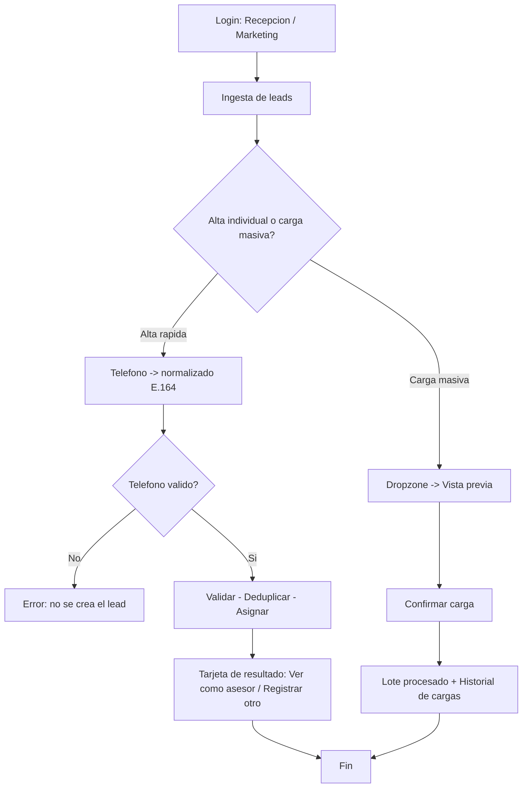

# Flujo del perfil — Recepción / Marketing

> Perfil de entrada de leads. Pantalla única: **Ingesta de leads** (`#/ingestion`).

## Perfil y objetivo

Recepción / Marketing es la **puerta de entrada** de los leads. Da de alta contactos puntuales (**alta rápida**) y carga lotes (**carga masiva**), confiando en que el sistema aplica solo las reglas: **normalización del teléfono**, **deduplicación**, **reingreso** y **asignación** por **adscripción de 30 días** o **Round-Robin**.

## Qué puede y qué NO puede

**Puede**

- Entrar como **"Entrar como Recepción / Marketing"** o con `recepcion@crm.test`.
- Usar el **alta rápida**: teléfono, fuente, proyecto y usuario de red social (opcional).
- Ver la **normalización E.164** en vivo mientras escribe el teléfono.
- Crear el lead con **"Crear y asignar lead"** y seguir el **stepper** de validación.
- Ver la **tarjeta de resultado** con el asesor asignado y el **motivo**, y usar **"Ver como …"** (abre el pipeline del asesor asignado) y **"Registrar otro"**.
- Simular una **carga masiva** en la **dropzone**, revisar la **Vista previa** con resultados por fila y **"Confirmar carga"**.
- Consultar el **Historial de cargas**.

**NO puede**

- Ver el pipeline, el dashboard, los leads existentes ni el equipo.
- Mover fases, cambiar temperatura, descartar o reasignar leads.
- Crear usuarios ni cambiar configuración.

## Pantalla

| Pantalla | Ruta | Contenido |
|---|---|---|
| **Ingesta de leads** | `#/ingestion` | **Alta rápida** (izquierda) + **Carga masiva** y **Historial de cargas** (derecha) |

## Flujos paso a paso (a nivel de clic)

### 1. Alta rápida de un lead

1. Entra como **Recepción / Marketing**: aterriza en **Ingesta de leads**.
2. En **"Teléfono"**, escribe por ejemplo `987 654 321`. Observa el recuadro **"E.164 normalizado"**: se completa a `+51 987 654 321`.
3. Elige **Fuente** (por ejemplo, **META_ADS**) y **Proyecto** en los selectores.
4. (Opcional) Escribe el **"Usuario de red social"**.
5. Pulsa **"Crear y asignar lead"**. Verás el **stepper**: **Validando teléfono**, **Deduplicando contacto**, **Asignando asesor**.
6. Al terminar aparece la **tarjeta de resultado** con **Cliente**, **Teléfono**, **Asignado a** y **Motivo** (p. ej. **"Round-Robin entre asesores disponibles"** o **"Adscripción 30 días (mismo asesor)"**).
7. Pulsa **"Ver como …"** para abrir el pipeline del asesor, o **"Registrar otro"** para vaciar el formulario y continuar.

### 2. Teléfono inválido (no se crea el lead)

1. Escribe un teléfono con menos de 9 dígitos o que no empiece con `9` (por ejemplo `12`).
2. Pulsa **"Crear y asignar lead"**.
3. Aparece la tarjeta de error **"No se pudo crear el lead"** con el mensaje **"El teléfono no es válido. Debe tener 9 dígitos y empezar con 9 (móvil de Perú)."** y un aviso en rojo. **No** se crea el lead.

### 3. Carga masiva

1. En **"Carga masiva"**, pulsa la **dropzone** **"Arrastra un archivo aquí"** (o haz clic para simular la carga).
2. Se muestra la **"Vista previa"** con las filas detectadas: válidas, **Reingreso**, y **rechazadas** con su motivo (por ejemplo, **"Teléfono inválido"**, **"menos de 9 dígitos"**).
3. Pulsa **"Confirmar carga"** (o **"Cancelar"** para descartar). La barra de progreso avanza.
4. Al terminar: **"Lote procesado: N aceptadas · N reingresos · N rechazadas."** y el lote se suma al **Historial de cargas**.

## Atajos

| Tecla | Acción |
|---|---|
| `Ctrl` + `K` | Búsqueda rápida de pantallas |
| `D` | Mostrar / ocultar el **Modo demostración** |
| `?` | Ayuda (**Guía de mi rol**, atajos, reglas) |
| `Esc` | Cerrar diálogo o panel activo |
| `Enter` / `Espacio` | Activar la dropzone o el control enfocado |

## FAQ

**¿Qué hace exactamente el sistema al guardar?**
Normaliza el teléfono a E.164, **deduplica** por teléfono, marca **Reingreso** si el contacto ya existía y asigna por **adscripción de 30 días** (mismo asesor) o **Round-Robin** entre asesores **disponibles**.

**¿Por qué un asesor en pausa no recibe el lead?**
Porque Round-Robin **omite** a los asesores con la recepción en pausa.

**¿Qué es un "Reingreso"?**
Un contacto que ya existía. Si vuelve **antes de 30 días**, conserva a su asesor original; si vuelve **después**, se reasigna por Round-Robin.

**¿Puedo ver los leads que ya están en el pipeline?**
No. Este perfil solo da de alta y controla lotes; la gestión del pipeline es del Asesor y de Gerencia.

**¿La carga masiva crea leads de verdad en el prototipo?**
Registra el lote en el **Historial** y en la **Auditoría**; al no haber backend, no persiste entre recargas.
