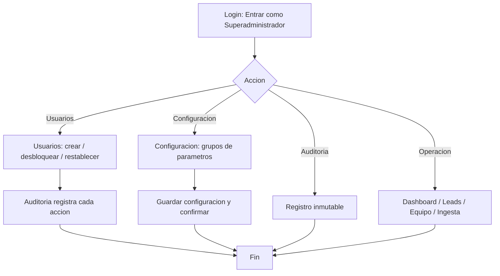

# Flujo del perfil — Superadministrador

> Perfil de administración total. Pantallas: **Dashboard**, **Leads**, **Equipo**, **Ingesta**, **Auditoría**, **Usuarios**, **Configuración**.

## Perfil y objetivo

El Superadministrador gobierna **accesos** y **parámetros**: crea usuarios y les asigna rol, **desbloquea** cuentas y **restablece contraseñas**, y revisa la **auditoría**. Además conserva el acceso operativo de Gerencia (dashboard, leads, equipo, ingesta, reportes).

## Qué puede y qué NO puede

**Puede**

- Entrar como **"Entrar como Superadministrador"** o con `admin@crm.test`.
- Todo lo de **Gerencia** (Dashboard, Leads, Equipo, Ingesta, Auditoría).
- **Crear usuarios** (**"Crear usuario"**) con nombre, correo y rol.
- **Desbloquear** cuentas bloqueadas (**"Desbloquear"**).
- **Restablecer claves** (**"Restablecer clave"**), sin verlas.
- Revisar y filtrar la **Auditoría** (registro inmutable).
- Consultar los grupos de **Configuración** y **"Guardar configuración"**.

**NO puede** (o no aplica)

- No hay una pantalla superior a esta: es el rol de mayor privilegio del prototipo.
- Los **valores de Configuración** se muestran como referencia en esta versión del prototipo (no hay edición de campos ni persistencia real; el prototipo no tiene backend).

## Pantallas

| Pantalla | Ruta | Contenido |
|---|---|---|
| **Dashboard** | `#/dashboard` | Consolidado (igual que Gerencia) |
| **Leads** | `#/leads` | Lista global con selección y **Reasignar selección** |
| **Equipo** | `#/team` | Disponibilidad y carga por asesor |
| **Ingesta** | `#/ingestion` | Alta rápida y carga masiva |
| **Auditoría** | `#/audit` | Registro inmutable con filtros **Actor** / **Acción** |
| **Usuarios** | `#/users` | Alta de usuarios, **Desbloquear**, **Restablecer clave** |
| **Configuración** | `#/settings` | Parámetros del sistema y **"Guardar configuración"** |

## Flujos paso a paso (a nivel de clic)

### 1. Crear un usuario

1. Entra como **Superadministrador** y abre **Usuarios**.
2. Pulsa **"Crear usuario"**.
3. En el diálogo **"Crear usuario"** completa **Nombre completo** y **Correo corporativo**, elige el **Rol** entre los chips (**Asesor comercial**, **Gerencia**, **Recepción / Marketing**, **Superadministrador**).
4. Pulsa **"Crear usuario"**. El usuario aparece en la tabla y queda registrado en **Auditoría**.

### 2. Desbloquear una cuenta

1. La cuenta `jorge@crm.test` figura como **"Bloqueado (5 intentos)"**.
2. En **Usuarios**, pulsa **"Desbloquear"** en esa fila. El estado pasa a **"Activo"**.
3. Cierra sesión (**"Cambiar rol / salir"**) e inicia sesión con `jorge@crm.test` y cualquier contraseña: entrarás al perfil **Asesor** con la cuenta ya desbloqueada.

### 3. Restablecer una contraseña

1. En **Usuarios**, pulsa **"Restablecer clave"** en cualquier fila.
2. En el diálogo **"Restablecer contraseña"** confirma con **"Enviar enlace"**.
3. Aparece **"Enlace enviado a …"** y el evento queda en **Auditoría**.

### 4. Revisar y guardar configuración

1. Abre **Configuración**. Verás cuatro grupos: **Asignación de leads**, **SLA y temperatura**, **Sesión y seguridad**, **Regional**.
2. Pulsa **"Guardar configuración"**.
3. Confirma en **"Guardar configuración" → "Los cambios se aplican a todo el prototipo. ¿Continuar?"** con **"Guardar"**. Aparece **"Configuración guardada."** y el evento queda auditado.

### 5. Demostrar el bloqueo por intentos

1. En el **login**, escribe `jorge@crm.test` y pulsa **"Entrar con credenciales"**.
2. Se muestra el banner **"Cuenta bloqueada tras 5 intentos fallidos. Un superadministrador debe desbloquearla."** y no se entra.
3. Desbloquéala desde **Usuarios → Desbloquear** y reintenta.

## Atajos

| Tecla | Acción |
|---|---|
| `Ctrl` + `K` | Búsqueda rápida (leads y pantallas) |
| `D` | Mostrar / ocultar el **Modo demostración** |
| `?` | Ayuda (**Guía de mi rol**, atajos, reglas) |
| `Esc` | Cerrar diálogo, menú o drawer |
| `Enter` / `Espacio` | Activar el control enfocado |

## FAQ

**¿Puedo ver la contraseña de un usuario?**
No. **"Restablecer clave"** solo envía un enlace de restablecimiento; nunca muestra la clave.

**¿El desbloqueo es permanente en el prototipo?**
Vive en memoria: con **Reiniciar demo** o al recargar, `jorge@crm.test` vuelve a estar bloqueado (a propósito, para demostrar el flujo).

**¿La configuración se guarda de verdad?**
En esta versión del prototipo los parámetros se muestran como referencia y **"Guardar configuración"** confirma, avisa y deja registro en la auditoría. La edición con persistencia llega con el sistema real.

**¿Por qué este rol ve el Dashboard y no solo Usuarios?**
Porque el Superadministrador es un rol de máxima confianza: conserva la operación completa además de la administración.

**¿Dónde veo quién hizo qué?**
En **Auditoría**: cada acción de la sesión queda registrada con **Cuándo · Actor · Rol · Acción · Entidad · Detalle**.
